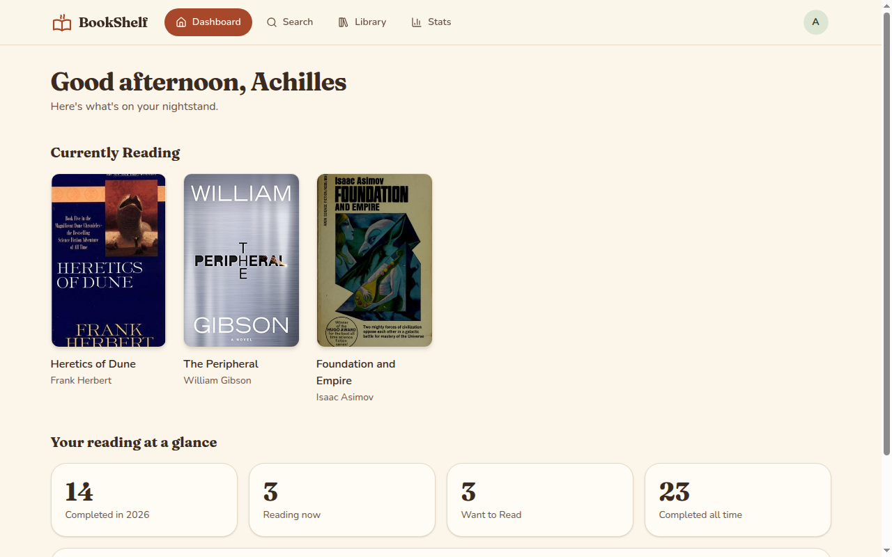
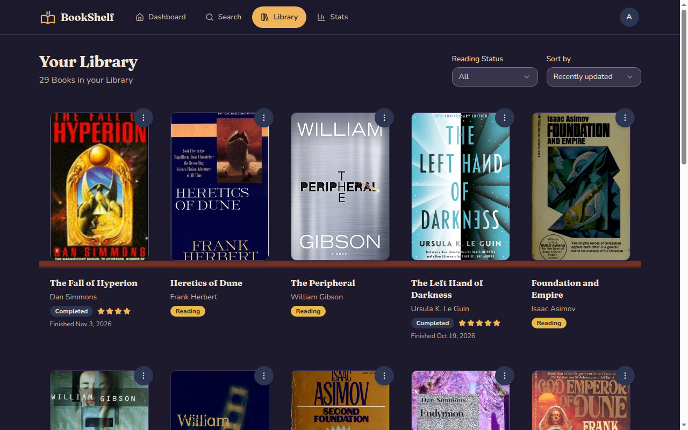
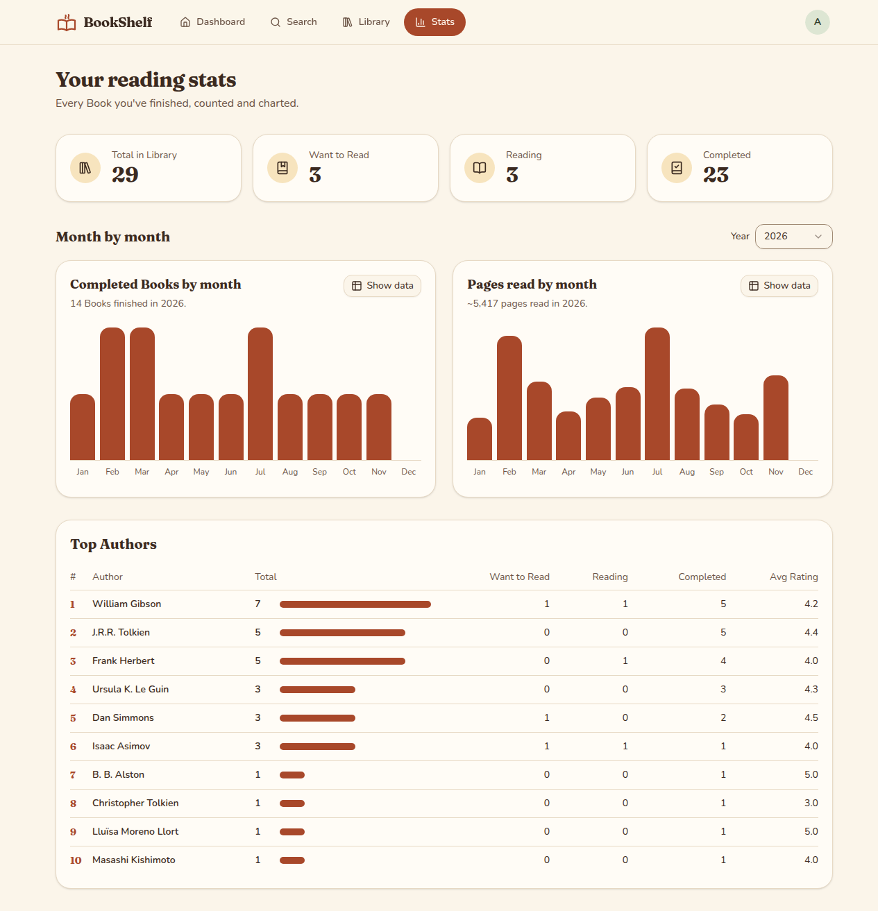
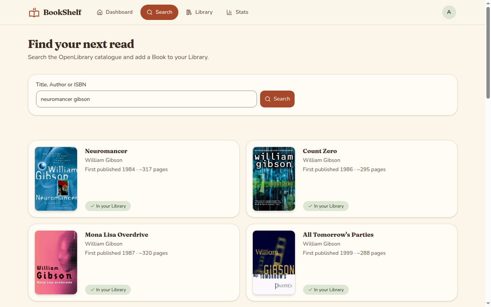
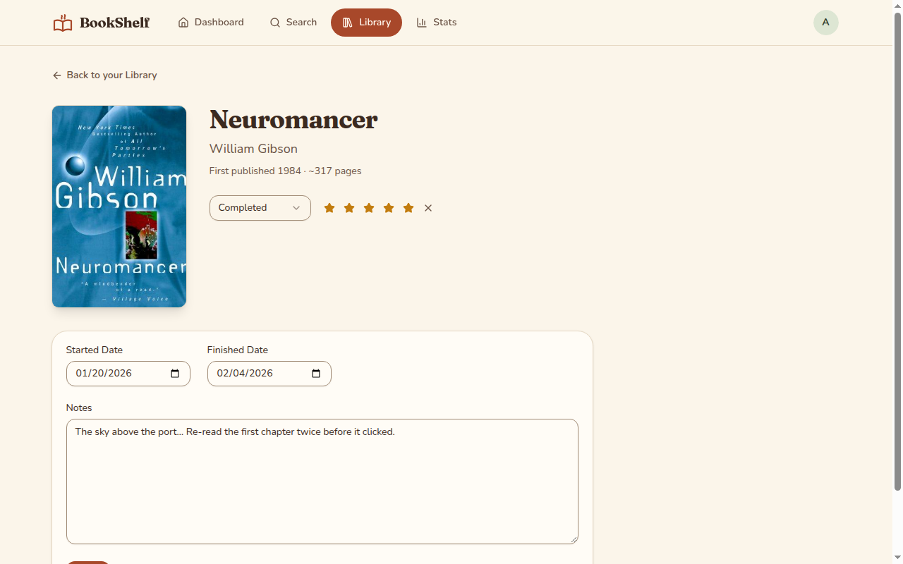
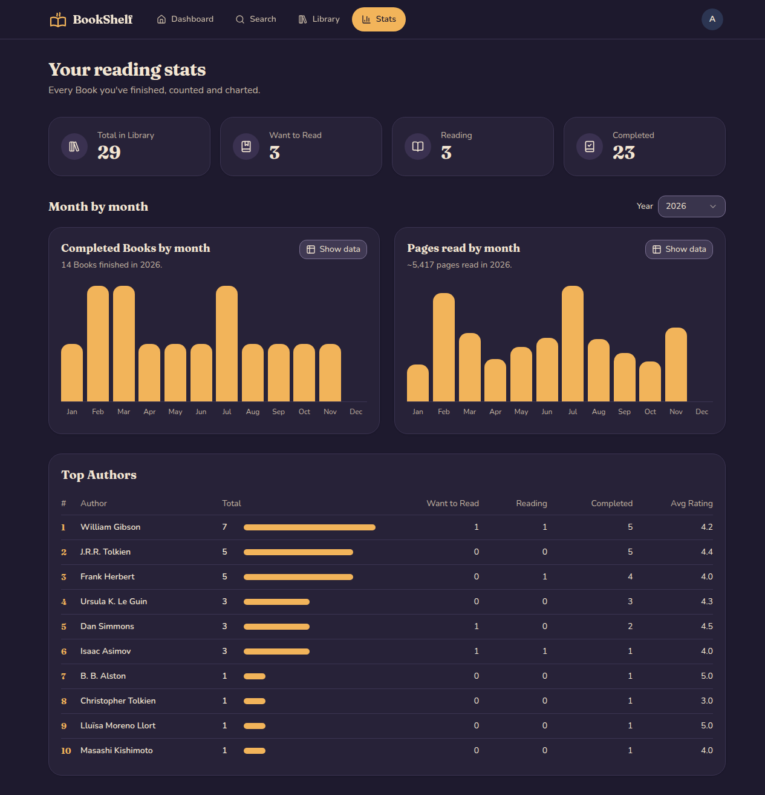
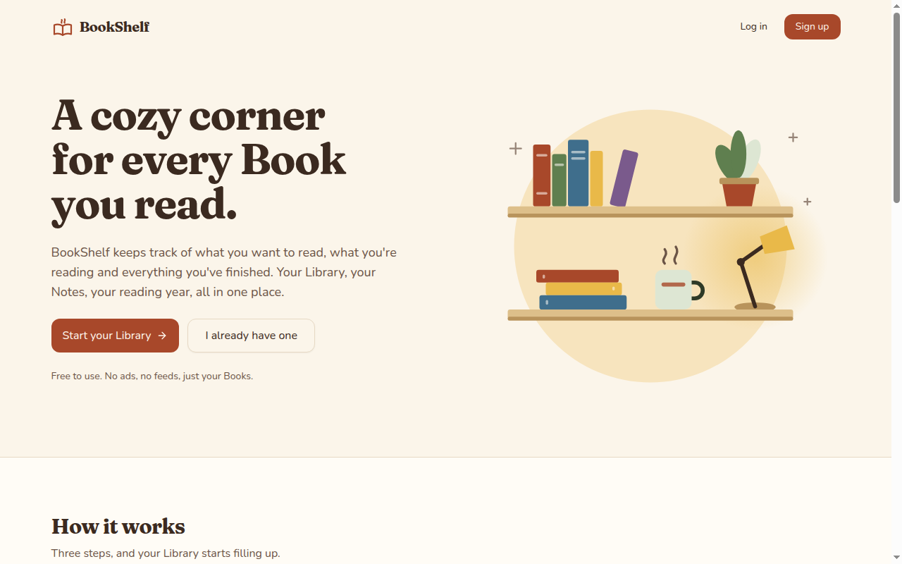
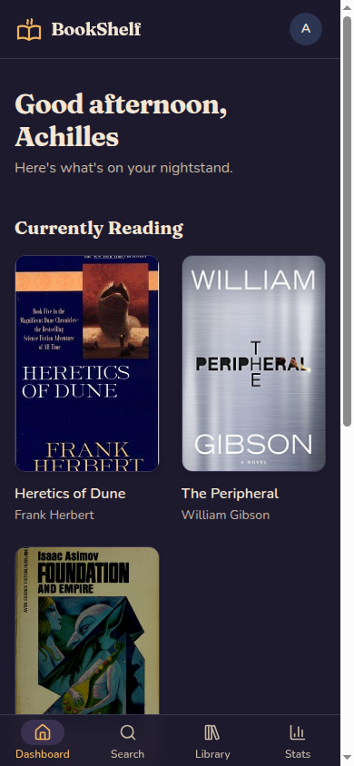
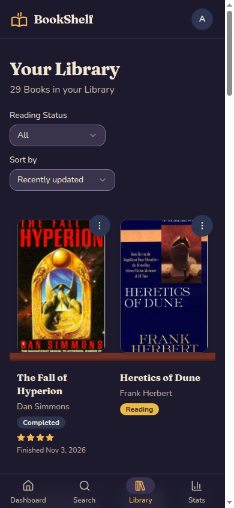

# BookShelf

A personal reading tracker. Find a Book on OpenLibrary, add it to your Library in one click, move it from _Want to Read_ to _Reading_ to _Completed_, and see your reading year in charts.

Built with Laravel 13, Inertia v3 and Vue 3, using an **AI-assisted, agent-driven workflow** with Claude Code. Every feature went from a brainstorm to a plan, a reviewed plan, an implementation, a multi-agent code review and written-up lessons. Each of those steps left a file in this repository, so you can follow how the app was built as well as what it does.



| Library (dark)                                                        | Stats                                                                               |
| --------------------------------------------------------------------- | ----------------------------------------------------------------------------------- |
|     |  |
| **Search**                                                            | **Library Entry**                                                                   |
|  |    |
| **Stats (dark)**                                                      | **Homepage**                                                                        |
|            |                                  |

<p align="center">
  
  &nbsp;&nbsp;
  
</p>

## Features

- **Search** OpenLibrary by title, Author or ISBN, and add a result with a starting Reading Status.
- **Library** shown as cover shelves, filtered by Reading Status and sorted by recently updated, title or Finished Date. A quick menu on each cover changes Status and Rating without leaving the shelf.
- **Library Entry** page with Started and Finished dates, a 1–5 star Rating and private Notes. Dates fill themselves in when the Status changes, and you can still edit them.
- **Stats**: Library totals by Status, Completed Books and approximate pages read per month for any year (each chart can show its data as a table), and Top Authors with per-Status counts and average Rating.
- **Dashboard** with what you're reading now and a summary of your year.
- Light and dark themes, a mobile layout with bottom tabs, and keyboard and screen-reader support throughout.

## How it was built

I directed the work, and AI agents did most of the typing and checking. I made the decisions: scope, trade-offs, which review findings to fix. The agents researched, planned, wrote code, reviewed it, tested it in a browser and wrote up what they learned. The repository holds the output of each step.

```
 brainstorm ─▶ plan ─▶ plan review ─▶ build ─▶ multi-agent review ─▶ browser check ─▶ write-up
    │           │           │            │              │                                 │
 docs/       docs/      plan edits    commits        todos/                         docs/solutions/
 brainstorms plans                                 (findings)                         (lessons)
```

| Step                   | What happens                                                                                                                                                                                             | Where to look                                               |
| ---------------------- | -------------------------------------------------------------------------------------------------------------------------------------------------------------------------------------------------------- | ----------------------------------------------------------- |
| **Brainstorm**         | An agent questions me about the why and the what until scope, non-goals and trade-offs are settled.                                                                                                      | [`docs/brainstorms/`](docs/brainstorms/)                    |
| **Domain model**       | Terms are pinned down in a glossary, along with words to avoid. Lasting decisions become ADRs.                                                                                                           | [`GLOSSARY.md`](GLOSSARY.md), [`docs/adrs/`](docs/adrs/)    |
| **Plan**               | Research agents map the codebase, past lessons, ADRs and library docs. The plan lists its premises, each tagged `user`, `observed` (with `file:line`) or `inferred`, so every assumption can be checked. | [`docs/plans/`](docs/plans/)                                |
| **Plan review**        | Reviewer agents read the plan before any code exists. I approve their edits, and they are committed as their own change.                                                                                 | e.g. `docs: apply technical review to Stats expansion plan` |
| **Build**              | Small commits in [Conventional Commits](https://www.conventionalcommits.org/) style, tests written with each change, and a `## Deviations` section in the plan when reality differs from it.             | `git log`                                                   |
| **Multi-agent review** | Several specialist reviewer agents (for example Laravel, Vue and security) review the change. Their findings become prioritised todo files, and I decide which ones get fixed.                           | [`todos/`](todos/)                                          |
| **Browser check**      | An agent drives a real browser through the changed pages at 1280px and 375px, in light and dark mode, using only the keyboard and with reduced motion.                                                   | `## Verification` in each plan                              |
| **Write-up**           | Every bug that took real effort is written up so that the next plan avoids it.                                                                                                                           | [`docs/solutions/`](docs/solutions/)                        |

### Giving the agents context

- **[`CLAUDE.md`](CLAUDE.md)**: the project brief every session starts from: stack, constraints (queries must run on both MySQL and SQLite), directory layout and where the docs live.
- **[`GLOSSARY.md`](GLOSSARY.md)**: the domain's vocabulary, used in class names, props and UI copy. A reviewer agent flags copy that uses an avoided word ([todo 007](todos/007-complete-p3-copy-uses-glossary-avoided-words.md)).
- **MCP servers**: [Laravel Boost](https://github.com/laravel/boost) for version-specific docs, database schema and logs; Playwright and Chrome DevTools for checks in the browser.
- **Custom-built Claude Code skills and agents** that encode the workflow above, plus Laravel Boost's framework skills for Laravel, Inertia, Tailwind, Wayfinder and Pest.

### What code review caught

Twelve findings were filed and fixed across the two feature branches. A few examples:

- **P1: unsaved Notes were wiped** when the Reader changed a Rating, because the form was keyed on `updated_at` and remounted after every save ([todo 001](todos/001-complete-p1-unsaved-notes-wiped-on-rating-change.md)).
- **P2: an empty `?sort=` returned a 500** instead of falling back to the default sort ([todo 002](todos/002-complete-p2-empty-sort-param-500.md)).
- **P2: long OpenLibrary titles could overflow** a `varchar(255)` column ([todo 003](todos/003-complete-p2-long-title-overflows-varchar.md)).
- **P2: keyboard focus was lost, or moved silently to another Book**, after a quick-menu change re-sorted the shelf. It took several passes to fix fully, ending with a live-region announcement ([todos 005](todos/005-complete-p2-quick-menu-loses-focus-after-save.md), [008](todos/008-complete-p2-focus-fallback-scrolls-shelf-to-top.md), [010](todos/010-complete-p2-focus-follows-reordered-book-to-top.md), [011](todos/011-complete-p2-reorder-moves-focus-without-announcement.md)).

### What was written up

- [A SQLite `date` column holds two formats, so a `<= Dec 31` filter dropped Books finished on Dec 31](docs/solutions/database-issues/2026-11-06-sqlite-date-column-mixed-formats-drops-last-day.md). The tests passed while the app was wrong; the fix is a half-open date range.
- [`Str::limit()` cuts by display width, not by characters](docs/solutions/logic-errors/2026-11-05-str-limit-cuts-by-display-width.md)
- [Testing Inertia partial reloads and lazy props](docs/solutions/test-failures/2026-11-06-testing-inertia-partial-reload-lazy-props.md)
- [An Inertia form loses unsaved input when its key changes](docs/solutions/ui-bugs/2026-11-05-inertia-form-loses-unsaved-input.md)
- …and [more](docs/solutions/).

## Architecture notes

- **Shared catalogue** ([ADR-001](docs/adrs/ADR-001-shared-catalogue-of-openlibrary-works.md)): a Book is an OpenLibrary _work_, not an edition, and is shared by all Readers. Everything personal lives on the Reader's Library Entry, at most one per Book. Readers send only a work key; the server imports metadata from its own cached search results, so clients never write to the catalogue.
- **OpenLibrary client** (`app/Services/OpenLibrary.php`): server-side only, with search results cached for 24 hours, a limit of 20 searches a minute per Reader and 3 calls a second across the whole app, and an identifying User-Agent as OpenLibrary's usage policy asks.
- **Reading statistics** (`app/Services/ReadingStats.php`): grouped SQL that runs on both MySQL and SQLite, indexes on `(user_id, status)` and `(user_id, finished_on)`, and lazy props so that changing the year reloads only the charts.
- **Thin controllers**, Form Requests for validation, Actions for single operations (`app/Actions/Library/AddBookToLibrary.php`), and a `ReadingStatus` enum.
- **Frontend**: Vue 3 `<script setup>` with TypeScript and type-safe routes generated by Wayfinder. Charts and their data tables are accessible, and focus is managed across Inertia reloads. Every theme colour pair meets WCAG AA contrast, and animation stops under `prefers-reduced-motion`.

## Tech stack

| Layer      | Tools                                                                                 |
| ---------- | ------------------------------------------------------------------------------------- |
| Backend    | PHP 8.4, Laravel 13, Fortify (authentication)                                         |
| Frontend   | Vue 3 + TypeScript, Inertia.js v3 (SSR), Tailwind CSS 4, Wayfinder, reka-ui           |
| Data       | MySQL 8.4 (local), SQLite in-memory (tests and CI)                                    |
| Quality    | Pest (109 tests), PHPStan level 7, Pint, `vue-tsc`, Vite+ lint/format, GitHub Actions |
| AI tooling | Claude Code, Laravel Boost MCP, Playwright / Chrome DevTools MCP                      |

## Running locally

Requirements: PHP 8.4, Composer, Node 22 and a database (SQLite works out of the box).

```bash
git clone https://github.com/achillesp/bookshelf.git && cd bookshelf
composer setup            # install, copy .env, generate key, migrate, build assets
```

Set a contact address in `.env` so OpenLibrary can identify the app:

```dotenv
OPENLIBRARY_CONTACT=you@example.com
```

Then start the server, queue, logs and Vite together:

```bash
composer dev
```

Run every check that CI runs (lint, type checks, PHPStan, Pest):

```bash
composer ci:check
```

## Repository guide

```
app/Services/        OpenLibrary client, ReadingStats
app/Actions/         Single-purpose actions (AddBookToLibrary)
app/Enums/           ReadingStatus
resources/js/pages/  Inertia pages (Dashboard, Search, Library, Stats, ...)
tests/Feature/       Pest feature tests
docs/brainstorms/    Feature scope, settled before planning
docs/plans/          Implementation plans, with premises and deviations
docs/adrs/           Architecture decisions
docs/solutions/      Lessons from solved problems
todos/               Code-review findings and how each was fixed
GLOSSARY.md          Domain language
CLAUDE.md            Brief for AI coding agents
```
