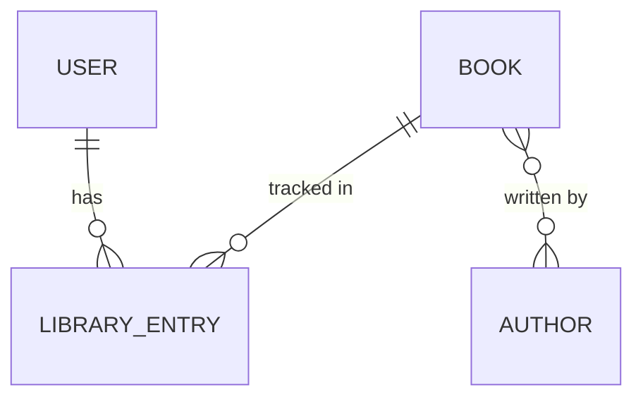

# feat: BookShelf MVP library, tracking and stats

## Context

Brainstorm: `docs/brainstorms/2026-11-05-bookshelf-mvp-brainstorm.md`; ADR-001 (shared catalogue of works); terms per `GLOSSARY.md`.
Search OpenLibrary, add Books to a private Library, track Reading Status/Rating/Notes/dates, show stats on the Dashboard.

## Premises

- `user` (brainstorm, What We're Building): "add a result to their Library with one click, choosing the starting Reading Status (Want to Read by default)"; "Results already in their Library are marked and cannot be added twice".
- `user` (brainstorm, What We're Building): date rules "→ Reading: Started Date set to today if empty, Finished Date cleared. → Completed: Finished Date set to today, Started Date too if empty. → Want to Read: both dates cleared"; "Finished cannot be before Started; neither can be in the future".
- `user` (brainstorm, What We're Building): Library "filtered by Reading Status, sorted by recently updated, title or Finished Date, paginated, and change Status and Rating directly from the list"; Dashboard stats "by month … for a chosen year", "top 10 Authors by number of Completed Books", "count of Library Entries in each Reading Status".
- `user` (brainstorm, Key Decisions): "approximate page count (… shown as "~412 pages")"; "Covers load directly from OpenLibrary's cover service"; "If OpenLibrary is down, the Library and Dashboard keep working; only search and adding new books stop".
- `user` (brainstorm, Why This Approach): search through our server "cache results briefly, rate-limit per Reader, and identify the app to OpenLibrary".
- `user` (ADR-001, Decision): Books and Authors are shared records keyed by OpenLibrary IDs; one Library Entry per Reader per Book.
- `user` (plan review, 2026-11-05): add should use "Cache each search result"; rate limit: "If cache has the result, search/add from cache. Otherwise limit both kinds of requests".
- `user` (plan review): promote starter-kit cleanup, Library indexes and the app-wide limiter: "In addition to app-wide openlibrary limit (3 req/s), add a per-user limit of 20/min, so that a single user cannot spend all requests."
- `user` (technical review): apply all review edits; cache TTL 24 h; "Use tha db cache with a ttl for now. We might use redis at a later point".
- `observed`: Redis not reachable locally (`new Redis()->connect('127.0.0.1', 6379)` → "Connection refused"); not in CI (`.github/workflows/tests.yml`); tests use `CACHE_STORE=array` (`phpunit.xml`).
- `user` (plan review): create `app/Services` and `app/Enums`; no extra status–date consistency rule beyond Finished ≥ Started and no future dates.
- `inferred`, costly: the catalogue is shared, so metadata written by one Reader is shown to all; accepting client-sent metadata would let any Reader corrupt it.
- `observed` (live, 2026-11-05): `search.json?q=dune&fields=key,title,author_name,author_key,first_publish_year,cover_i,number_of_pages_median` → `key:"/works/OL893414W"`, `author_key:["OL79034A"]`, `number_of_pages_median:608`; without `fields` the median is absent; missing data is omitted, not null; ~0.7–0.9 s per 20-result query.
- `observed` (live): `q=9780441172719` resolves to the Dune work; `q=key:/works/OL893414W` returns that single work with the same fields.
- `observed` (https://openlibrary.org/developers/api): "1 request/second", identified User-Agent ("MyLibraryApp (contact@example.org)") gets 3x; covers by id (`/b/id/{id}-M.jpg`) not rate-limited, hotlinking via covers.openlibrary.org requested.
- `observed`: local MySQL 8.4 (`php artisan db:show`), tests SQLite `:memory:` (`phpunit.xml:26-27`); migrations not yet run (`migrate:status` → "Migration table not found"); `.env` → `CACHE_STORE=database`.
- `observed`: dashboard is `Route::inertia('dashboard', 'Dashboard')` (`routes/web.php:7-9`); nav in `resources/js/components/AppSidebar.vue:20-26`; no chart library in `package.json`; no Textarea/Pagination UI components; no `app/Services`, `app/Enums`, `app/Policies`.
- `inferred`: a Reader completes at most hundreds of Books a year, so grouping a year's Completed entries by month in PHP is cheap.

## Reuse inventory

- Fortify auth and account deletion (`app/Http/Controllers/Settings/ProfileController.php:49-61`); Library removal via FK cascade.
- Patterns: Form Requests (`app/Http/Requests/Settings/ProfileUpdateRequest.php`), toast flash (`ProfileController.php:41-43`, `resources/js/lib/flashToast.ts`), `<Form>` + Wayfinder (`resources/js/pages/settings/Profile.vue:40-79`), confirm dialog (`resources/js/components/DeleteUser.vue`), breadcrumbs (`resources/js/pages/Dashboard.vue:6-15`), limiter style (`app/Providers/FortifyServiceProvider.php:75-84`).
- UI: Button, Input, Select, Badge, Card, Dialog, Label (`resources/js/components/ui/`); native `<input type="date">` / `<textarea>` with Tailwind.
- Framework: HTTP client, `Http::fake` + `preventStrayRequests`, `Cache::remember`, named `RateLimiter`, `createOrFirst`, paginator `withQueryString()`.
- User-Agent contact. Person supplies: operator via `OPENLIBRARY_CONTACT` env (required by OpenLibrary's policy). Code derives: impossible.
- Cache TTL (24 h, existing database store), search limit (20/min per Reader), timeouts (3 s, connect 2 s). Person supplies: env-overridable config (+2 settings). Code derives: constants in the service. Chosen: constants; nothing is deployed and no requirement asks for tuning.

## Design options

- **A (chosen):** server-side `OpenLibrary` service caching each search result list and each result per work key; add sends only the work key — existing Book is linked with no call, otherwise the per-work cache is read, and only on a miss is the work fetched via `q=key:/works/…`; a per-Reader limiter counts only cache misses (search and add); ownership by resolving entries through `$request->user()->libraryEntries()` (404 otherwise); plain Inertia GET/PATCH visits; monthly stats grouped in PHP; Vue/Tailwind bar chart; constants for TTL/limit/timeouts. New concepts: 10 (Book, Author, LibraryEntry models + pivot, `ReadingStatus` enum, `OpenLibrary` service, per-work cache entries, `AddBookToLibrary` action, miss-only per-Reader limiter, app-wide limiter (promoted), `OPENLIBRARY_CONTACT` env).
- **B (fewest concepts):** as A without per-work cache entries, and a route `throttle` on search and add counting every request. New concepts: 8. Ruled out by the `user` premise (plan review): cache per result, limit only real requests.
- **C:** as A, but the client posts full Book metadata on add (no lookup, no per-work cache). New concepts: 8. Ruled out by the costly `inferred` premise on the shared catalogue.

## Approach

- **Data:** migrations `books` (`openlibrary_id` unique, `title`, nullable `first_publish_year`, `cover_id`, `page_count_median`), `authors` (`openlibrary_id` unique, `name`), `author_book` (composite primary key `(book_id, author_id)`, both FKs cascade on delete; Authors attached only when the Book `wasRecentlyCreated`), `library_entries` (`user_id` FK cascade, `book_id` FK restrict, `status`, nullable `rating`, `notes`, `started_on`, `finished_on`, timestamps, unique `(user_id, book_id)`; `started_on`/`finished_on` cast `date:Y-m-d`, typed `string | null` in `resources/js/types/library.ts`). Models with `#[Fillable]` per `app/Models/User.php`, factories with status states, `User::libraryEntries()`.
- **`ReadingStatus`** enum in `app/Enums/` (`WantToRead`, `Reading`, `Completed`). **Date rules** on `LibraryEntry::changeStatus(ReadingStatus $status): void`; explicit dates from the request apply after. Finished ≥ Started is checked on the merged state (stored dates + status rules + request dates) in `LibraryEntry` before saving, throwing a `ValidationException` on `finished_on`. Test: PATCH only a `finished_on` earlier than the stored `started_on`.
- **`app/Services/OpenLibrary.php`:** `search(string $query, User $reader): array`, `findWork(string $workKey, User $reader): ?array`; User-Agent `BookShelf (<contact>)` from `config('services.openlibrary.contact')`, explicit `fields`, `limit=20`, timeouts; `Cache::remember` (24 h) on a normalised query key, and each mapped result also `Cache::put` under its work key with the same TTL; uses the existing database cache store (`CACHE_STORE=database`; tests `array`); the `cache` table migration must run; `findWork` reads the per-work key before calling OpenLibrary; failures throw and are never cached; docs mapped to an array shape (strip `/works/`, all but key/title optional).
- **Rate limit (misses only):** inside the service, before each real OpenLibrary call, `RateLimiter::tooManyAttempts` checks the per-Reader key `openlibrary:{id}` (20/60 s) and the app-wide key `openlibrary:global` (3/1 s, OpenLibrary's identified limit); both are `hit()` only when the call goes ahead, so a "busy" rejection costs the Reader nothing (test: `RateLimiter::remaining()` unchanged). Either limit throws a service exception that the search and add controllers turn into an error toast ("limit reached" / "busy, try again"); the search page keeps the query. Cache hits never count.
- **Routes** (`routes/web.php` auth group): `dashboard` → `DashboardController`; `search`; `library.index|store|show|update|destroy` (entries resolved via the Reader's relation). `app/Actions/Library/AddBookToLibrary` receives `OpenLibrary` via its constructor and owns the flow: look up the Book by `openlibrary_id` and the Reader's entry for it (before any HTTP call); if the Book is missing, call `findWork` before `DB::transaction`, then `createOrFirst` Book/Authors and the entry on `(user_id, book_id)`; an existing entry (`!wasRecentlyCreated`) gives an "already in your Library" toast. The controller only validates and maps the service exception to a toast. Form Requests in `app/Http/Requests/Library/` (store: work key matching `^OL\d+W$` + status default WantToRead, and `findWork` returns null unless the mapped key equals the requested key; update: `sometimes` status, rating 1–5 nullable, notes, dates `before_or_equal:today`, `finished_on` ≥ `started_on`). Library index validates `status` against `ReadingStatus` and maps `sort` through a fixed allowlist (title via a join to `books`); Dashboard validates `year` as an integer in a bounded range. Library index, every Dashboard stat and Search's "In your Library" flags query from `$request->user()->libraryEntries()`; a test checks a second Reader's Completed entries do not change the counts.
- **Pages:** `search/Index.vue` (GET form; cover, title, Authors, year, "~N pages"; "In your Library" badge; Add with status select defaulting to Want to Read; unavailable/empty states); `library/Index.vue` (status filter, sort, pagination links, inline status select + `RatingInput` via `router.patch` with `preserveScroll`, remove dialog); `library/Show.vue` (status and rating as separate controls that patch on change, like the Library list; a dates/notes form that never sends status, re-keyed on the entry's `updated_at` so server-set dates show; "~N pages"; test: PATCH `{status: completed}` leaves `finished_on` = today); `Dashboard.vue` (currently Reading, status counts, monthly bars with year select as GET `?year=`, top 10 Authors). Components `BookCover.vue` (`?default=false`, placeholder on error), `RatingInput.vue`; types `resources/js/types/library.ts`; sidebar items Dashboard/Search/Library.
- Skills to load: `laravel-best-practices`, `inertia-vue-development`, `wayfinder-development`, `tailwindcss-development`, `testing-best-practices`.

## Acceptance Criteria

- [ ] Search by title, author or ISBN shows up to 20 results with cover, Authors, year, ~pages; Library items marked; OpenLibrary down → message, Library/Dashboard still work.
- [ ] Add (default Want to Read) creates or reuses shared Book/Authors and one Library Entry with auto-filled dates; no duplicates; OpenLibrary down → error toast, nothing created.
- [ ] Status changes apply the date rules; dates/Notes editable, Finished ≥ Started, no future dates; Rating 1–5 or empty.
- [ ] Library: status filter, sort, pagination, inline status/rating, removal after confirmation.
- [ ] Another Reader's Library Entry returns 404 on show/update/delete.
- [ ] Dashboard: currently Reading, status counts, Completed per month for a chosen year, top 10 Authors by Completed Books.

## Task Breakdown

- [x] **Search OpenLibrary from a Search page** (AFK)
  - AC: `/search?q=dune` shows Dune with cover, Authors, year, ~608 pages; repeat search makes no HTTP call and is not rate-limited; connection failure shows "search unavailable"; 21st uncached OpenLibrary call in a minute shows a rate-limit toast; Search in sidebar
  - Blocked by: none
- [ ] **Add a search result to the Library** (AFK)
  - AC: Add defaults to Want to Read; creates Book, Authors, entry with auto-filled dates; adding right after a search makes no HTTP call (per-work cache); existing Book makes no HTTP call; uncached new Book counts toward the rate limit; result then shows "In your Library"; duplicate rejected; OpenLibrary down on a new Book → error toast, no rows
  - Blocked by: Task 1
- [ ] **Library page: browse, quick edit, remove** (AFK)
  - AC: filter/sort/paginate keep the query string; inline status/rating persist and apply date rules; remove after confirm; other Readers' entries → 404; Library in sidebar
  - Blocked by: Task 2
- [ ] **Library Entry page: dates and Notes** (AFK)
  - AC: edit status, rating, dates, notes; future dates or Finished < Started show errors; shows ~pages
  - Blocked by: Task 3 (extends its update endpoint)
- [ ] **Dashboard stats** (AFK)
  - AC: with factory entries, shows currently Reading, status counts, monthly bars for `?year=` (select lists years with Completed entries), top 10 Authors counting co-authored Books for each; empty states for a new Reader
  - Blocked by: Task 2
- [ ] **App-wide OpenLibrary limit** (AFK)
  - AC: with the per-Reader limit not reached, a 4th uncached OpenLibrary call within one second (any Readers) shows the "busy" toast and makes no HTTP call; per-Reader 20/min still applies
  - Blocked by: Task 1
- [ ] **Library indexes** (AFK)
  - AC: `library_entries` has indexes `(user_id, status)` and `(user_id, finished_on)` (added to its migration; nothing is deployed); `php artisan migrate:fresh` succeeds
  - Blocked by: Task 2
- [ ] **Starter-kit cleanup** (AFK)
  - AC: sidebar footer has no starter-kit repo/docs links (`resources/js/components/AppSidebar.vue:28-39`); `.env.example` has `APP_NAME=BookShelf`
  - Blocked by: none
- [ ] **Amend ADR-001 for the add lookup** (AFK)
  - AC: ADR-001 amended: "adding a book needs no extra API request while its search result is cached; otherwise one rate-limited lookup"
  - Blocked by: none

## Verification

- Seam: Pest feature tests in `tests/Feature/Library/` and `tests/Feature/SearchTest.php`, copying `tests/Feature/Settings/SecurityTest.php:18-24` and `tests/Feature/DashboardTest.php`; `Http::preventStrayRequests()` + exact-URL fakes asserting `fields=` was sent; unit tests for `changeStatus`.
- `php artisan test --compact`; `composer ci:check`.
- Browser (local, after `php artisan migrate`): search "dune" and an ISBN, add, change status inline, edit dates, remove, Dashboard; covers and missing-cover placeholder.
- Risk row 2: check `storage/logs` for duplicate-key errors after the browser run; also check for OpenLibrary 429/403 (would mean the app-wide limit is too high).
- Risk row 9: after the browser run, check the `cache` table row count.

## Not in MVP

| # | Kind | Item | Detail |
| --- | --- | --- | --- |
| 1 | risk (`inferred`) | All Readers share the server's OpenLibrary allowance | **promoted** (Task 6) |
| 2 | risk (`inferred`) | Duplicate-key error if two Readers first-import the same Book at once | Trigger: unique violation in logs → retry the action once |
| 3 | extra | Optimistic inline status/rating | Instant UI; +1 concept; plain patch is fast enough |
| 4 | extra | Partial reload for the year select | Less data per switch; +1 concept |
| 5 | extra | Env-tunable cache TTL / search limit | +2 settings; no deploy yet |
| 6 | extra | Indexes `(user_id, status)`, `(user_id, finished_on)` | **promoted** (Task 7) |
| 7 | extra | Remove starter-kit footer links, set `APP_NAME` | **promoted** (Task 8) |
| 8 | extra | Deferred search results; Redis cache; Author order on a Book | +1 concept each (Redis: later, per user) |
| 9 | risk (`inferred`) | Expired search cache rows pile up in the database `cache` table (~21 rows per uncached search) | Trigger: `cache` table row count keeps growing → schedule deletion of expired rows, or move to Redis (row 8) |

## Risks & Dependencies

- External: OpenLibrary latency/outages → 3 s timeout, failures never cached, Library and Dashboard never call it.
- Shared catalogue integrity (costly premise) → add accepts only a work key.
